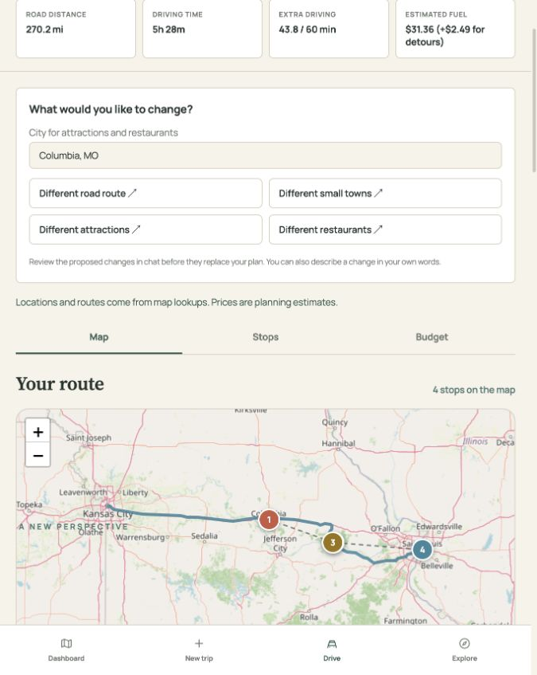

# Live road-trip planning with Strands

The current road-trip UI calls the existing Strands/Bedrock backend. The model decides which tools to call; Strands executes them; Python validates places, routes and fuel costs; React renders the resulting itinerary. The prior road-trip sample workspace remains available with `VITE_USE_MOCKS=true`.

## Run and try it

Use the existing backend AWS configuration in `docs/AWS_SETUP.md`. No new AWS service or API key is needed for the OSM/OSRM place and routing tools.

```sh
docker compose up -d --build
```

Open http://localhost:5173, choose **New trip**, enter the endpoints, interests and detour budget, and select **Find stops along my drive**. The map, stop list and budget update from a completed validated plan. Chat displays actual Strands specialist/tool events. If lookup or inference fails, the previous plan remains visible and chat offers retry.

The four actions request a different road route, different small towns along the route, different attractions in a chosen city, or different restaurants in that city. Free-text revisions use the same service. An existing itinerary is replaced only after the traveler approves its change preview. Rejecting a preview retains the original. The preview includes measured driving detour and fuel estimates.

## Components and tools

- `roadtrip/RoamApp.tsx` creates isolated browser-session journeys and sends the form through the existing chat service.
- `features/chat/api/chatService.ts` handles SSE, history, errors, request isolation and `/api/ask/{run_id}/resume`.
- `roadtrip/api/roadTripStore.ts` supplies typed per-journey driving constraints. Changed constraints invalidate outstanding reviews.
- `roadtrip/components/DriveWorkspace.tsx` reuses the existing chat, approval, Leaflet map, plan and budget components.
- The current main branch's city suggestions, date picker, detour slider/custom-minute entry and direct-drive preview remain in `TripSetup.tsx`. Its latest prototype workspace is preserved byte-for-byte in `DemoDriveWorkspace.tsx`, including `DriveMap` and discovery/photo controls, and runs with `VITE_USE_MOCKS=true`. Live mode uses the verified itinerary map and does not connect community photo discovery. The prototype `fetchDrivePlan` adapter remains cached and is not used by live planning.
- `backend/agent.py` and `orchestration.py` provide the existing orchestrator and Places, Transport and Budget specialists on Bedrock.
- `find_places`, `locate`, `get_forecast` and `plan_drive` reuse the existing providers. `find_places(exclude_current=True)` omits already-selected source records. `find_route_towns` samples five positions on the route and verifies towns/villages through the existing location provider.
- `backend/roadtrip.py` supplies request-local route caching and complete-route validation. `plan_drive(via=[...], alternative=True)` previews provider-supplied alternatives. The form endpoints, detour budget and daily mileage limit remain authoritative. The current form preserves main's removal of the fuel-entry card; live planning uses disclosed assumptions of 28 MPG and $3.25/gallon from `defaultFuelAssumptions` in `roadTripStore.ts`. The API can accept explicit different fuel assumptions.

## Quick changes to one stop

Changing one stop used to mean a specialist agent's lookups and then the orchestrator writing the
whole itinerary out again for `check_budget`. For a road trip with a current plan, the orchestrator
now also holds two tools from `backend/quick_edits.py` and is told to use them first:

- `find_options(kind, stop_id | city, keyword, interests)` returns real places with an `option_id`:
  `"town"` for other towns and stops along the route (the route search in `tools/route_search.py`),
  or `"attraction"`, `"restaurant"`, `"stay"` near a stop or in a town. Places already in the plan
  are left out, and every option is recorded as evidence.
- `edit_stops(remove_ids, add_option_ids)` changes only those items in code: a new item gets its day
  and time from its position on the road, a lunch picked for a stop that moves away is re-picked
  near the new stop, and the draft goes through the same accuracy check and whole-route detour check
  as any other (`ItineraryUpdates.stage`). Over budget means "rejected" and nothing changes.

`update_itinerary` with no arguments then raises the usual approval card. That is three short model
calls and no model-written itinerary. A different road, new cities or dates, or a rebuilt plan still
go through the specialists and `check_budget`.

## API additions

`POST /api/ask` and `/api/ask/stream` accept an optional `road_trip` object:

```json
{
  "origin": "Kansas City, MO",
  "destination": "St. Louis, MO",
  "detour_minutes": 60,
  "mpg": 28,
  "gas_price": 3.25
}
```

The existing `max_drive_miles_per_day` field supplies the daily distance limit. The detour allowance accepts whole minutes from 0 through 600, matching the current form's slider and exact typed values. Completed itineraries optionally include `roadTrip`, with measured one-way mileage, direct and selected driving times, total detour, estimated total/extra fuel, assumptions and route option.

For these requests, `check_budget` first validates place evidence and measures the route through all distinct visit locations in itinerary date/time order. It rejects unknown locations, more than ten intermediate locations, excess total detour, or insufficient trip dates for driving days. It replaces model-written Driving costs and geometry with provider data before calculating the budget. The Budget specialist reads this measured draft. The result is frozen so review and publication use the identical validated route without repeating network calls after approval.

The agent previews its selected waypoints before writing the draft. Three rejected drafts stop the run with an actionable error and preserve the previous plan. Completed chat replies use the backend's measured one-way figures, so a model cannot relabel the confirmed fuel or mileage as a round trip.

## Limits

Plans and conversations are held in browser memory; reload clears them. Pending agent reviews are held in one backend process and expire after 15 minutes. Public OSM/OSRM services can be slow or unavailable. Alternative routes are not guaranteed; no substitute is invented. Five-position town discovery is bounded and not exhaustive. Town/village classifications are map labels, not population checks. Place search uses a radius and may include neighboring localities; it does not enforce municipal boundaries. Travel durations exclude traffic and visits. Fuel prices are assumptions, and tolls, parking, rental costs, bookings and availability are not supplied.

## Verification

```sh
docker compose exec -T backend python -m pytest -q
docker compose exec -T frontend npm test
docker compose exec -T frontend npm run build
```

Regression tests exercise real Strands tool/interrupt behavior with a scripted model, combined-detour rejection, measured fuel, unavailable alternatives, exclusion and source recording, exact preview reuse, refusal to publish failed drafts, per-journey form transmission and stale-review protection. No AWS requests are made by these automated tests.

Verified locally: 152 backend tests plus 12 subtests, 28 frontend tests, and the production frontend build pass. A live Bedrock run completed through Places, Transport and Budget using verified OSM places and an OSRM route; this is separate from the scripted-model tests. The default Kansas City → St. Louis browser flow also completed with three verified stops: 270.3 miles, 44.2 extra driving minutes within a 60-minute allowance, and $31.37 estimated fuel at 28 MPG and $3.25/gallon. Recommendations and provider routes may differ on subsequent runs.

The live restaurant action proposed replacing Columbia's Twain stop with 44 Canteen, preserved the two Hermann stops, and paused with a measured review card. Approving that native Strands interrupt updated the map to the reviewed 270.2-mile route and $31.36 fuel estimate.

These live checks preceded integrating the latest main UI updates; all automated tests and the production build were repeated after resolving that integration. Review the trip form and both live/demo workspaces before merging.


